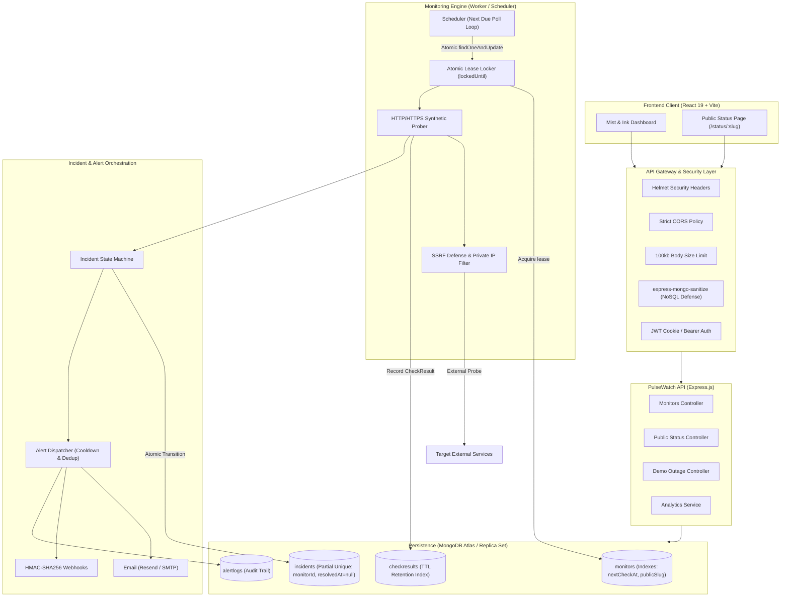
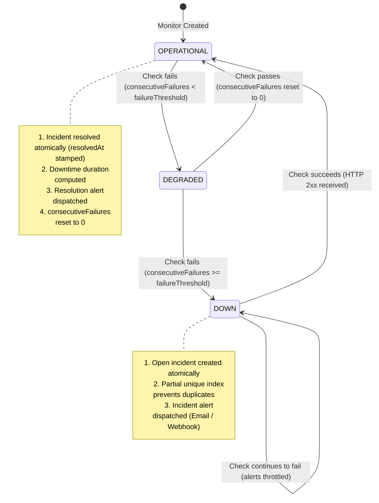

# PulseWatch

> Quiet, developer-first uptime monitoring, incident orchestration, and status page platform.

PulseWatch monitors critical HTTP/HTTPS endpoints on configurable schedules, tracks DNS & network latency, deterministically transitions through an atomic incident state machine, deduplicates alerts across webhooks and email, and generates transparent public status pages. Designed with an editorial **"Mist & Ink"** aesthetic inspired by fine stationery.

[](https://github.com/Adit-2006/PulseWatch/actions/workflows/ci.yml)
[](LICENSE)
[](https://nodejs.org/)
[](https://react.dev/)

---

## Live Links & Demo

- **Live Application**: [https://pulsewatch-frontend.onrender.com](https://pulsewatch-frontend.onrender.com) _(Configure your custom domain / Render deployment)_
- **API Health Endpoint**: [https://pulsewatch-api.onrender.com/api/health](https://pulsewatch-api.onrender.com/api/health)
- **Demo Video Walkthrough**: [Watch the 3-Minute Demo Video]((https://docs.google.com/videos/d/1BjlLpMhwHhdKCl7dVP3cpVoJB307q-Mrj_MTRRQPXkM/play?usp=sharing))

---

## Table of Contents

- [Problem & Target Users](#problem--target-users)
- [Key Features](#key-features)
- [System Architecture](#system-architecture)
- [Incident State Machine](#incident-state-machine)
- [Key Technical Decisions & Trade-Offs](#key-technical-decisions--trade-offs)
- [Security Hardening](#security-hardening)
- [Getting Started](#getting-started)
- [Environment Variables](#environment-variables)
- [Testing & Quality Assurance](#testing--quality-assurance)
- [Simulated Outage Demo Route](#simulated-outage-demo-route)
- [Deployment Guide](#deployment-guide)
- [Known Limitations](#known-limitations)
- [License](#license)

---

## Problem & Target Users

### The Problem

Modern web products and distributed APIs fail silently. Engineering teams often discover outages through disgruntled user complaints on social media rather than automated alerts. Existing application performance monitoring (APM) and SaaS uptime tools are frequently:

1. **Cost-Prohibitive & Bloated**: Packed with legacy telemetry features that overwhelm small teams.
2. **Prone to Alert Fatigue**: Transient network hiccups trigger false-positive alert floods at 3:00 AM.
3. **Visually Cluttered**: Generic dark dashboards full of dense tables and noisy charts rather than clear, high-signal information.
4. **Disconnected from Public Communication**: Incident records and public status pages require separate, uncoordinated subscriptions.

### Target Users

- **Backend & Full-Stack Developers**: Need lightweight, zero-maintenance synthetic probing for microservices and webhook receivers.
- **DevOps & SRE Teams**: Require reliable consecutive threshold verification, deterministic incident lifecycles, and automated notifications without vendor lock-in.
- **Indie Hackers & Small Engineering Teams**: Want clean, high-precision uptime tracking paired with a gorgeous public status page.

---

## Key Features

- **Proactive Synthetic Probing**: HTTP/HTTPS checks with configurable intervals (10s to 24h), custom HTTP methods (`GET`, `POST`, `HEAD`, etc.), expected status codes, and latency tracking.
- **Atomic Incident State Machine**: Concurrency-safe state transitions across `OPERATIONAL`, `DEGRADED`, and `DOWN` powered by atomic MongoDB lease locking.
- **Flapping & Blip Mitigation**: Configurable failure thresholds (e.g., 3 consecutive failures) ensure transient network blips do not wake up engineers.
- **Deduplicated Multi-Channel Alerts**: Automated notifications dispatched via **Resend**, **SMTP**, and **HMAC-SHA256 Signed Webhooks** with cooldown protection.
- **Public Status Pages**: Shareable, read-only status pages (`/status/:slug`) with 90-day daily uptime history bars and incident logs.
- **Editorial "Mist & Ink" Design System**: Calm, stationery-inspired aesthetic with Instrument Serif display typography, Hanken Grotesk body text, Catmull-Rom sparklines, pill buttons, and zero visual clutter.
- **Interactive Outage Simulation**: Dedicated demo endpoints (`/api/demo/probe` & `/api/demo/toggle`) enabling live demonstrations of outage detection and recovery.
- **Enterprise-Grade Security**: Helmet security headers, strict CORS origins, 100kb body size caps, NoSQL query injection sanitization, and SSRF loopback protections.

---

## System Architecture

PulseWatch operates as a coordinated monorepo separating API services, background scheduling, database storage, and the React client:



---

## Incident State Machine

PulseWatch utilizes a deterministic, atomic state machine to govern incident lifecycles without race conditions:



### Transition Mechanics

1. **Flapping Suppression**: When a healthy monitor experiences a check failure, it enters `DEGRADED`. An incident is **not** immediately declared.
2. **Threshold Reached**: When consecutive failures equal or exceed `failureThreshold` (default: 3), an incident is created atomically.
3. **Automatic Healing**: As soon as a subsequent check returns a matching HTTP response code, the incident is resolved, duration is recorded, and resolution notifications are delivered.

---

## Key Technical Decisions & Trade-Offs

### 1. Atomic Operations Over Distributed Lock Managers (Redis / Redlock)

- **Decision**: Used MongoDB atomic operations (`findOneAndUpdate` with `lockedUntil` timestamp comparisons) for scheduler lease acquisition instead of introducing Redis or ZooKeeper.
- **Rationale**: Keeps operational complexity and infrastructure costs minimal for single-cluster and small deployments. Multiple concurrent workers can safely poll `nextCheckAt: { $lte: new Date() }, lockedUntil: { $lt: new Date() }` and atomically claim a lease (`lockedUntil = now + leaseDuration`).
- **Trade-Off**: Polling overhead is bounded by MongoDB indexing (`{ nextCheckAt: 1, lockedUntil: 1 }`). If worker capacity scales past dozens of instances, an in-memory queue (e.g., BullMQ) can be swapped in without modifying probing business logic.

### 2. Partial Unique Index for Incident Concurrency Safety

- **Decision**: Enforced an active incident constraint using MongoDB's partial unique index:
  ```javascript
  incidentSchema.index(
    { monitorId: 1 },
    {
      unique: true,
      partialFilterExpression: { resolvedAt: null },
    }
  );
  ```
- **Rationale**: Guarantees at the database engine level that **no monitor can ever have more than one open incident**, even if multiple concurrent workers execute overlapping checks during clock skews or network partitions.
- **Trade-Off**: Resolved incidents (`resolvedAt: Date`) are excluded from the constraint, allowing full historical logs while maintaining bulletproof integrity for active outages.

### 3. Automated Time-Series Data Retention via MongoDB TTL Index

- **Decision**: Health check results (`CheckResult`) are automatically pruned using native MongoDB TTL indexes on `checkedAt`:
  ```javascript
  checkResultSchema.index({ checkedAt: 1 }, { expireAfterSeconds: env.RETENTION_DAYS * 86400 });
  ```
- **Rationale**: Time-series health checks accumulate millions of records. TTL indexing delegates deletion directly to MongoDB's internal background thread, eliminating external cron jobs or custom garbage collection queries.

### 4. In-Process Worker Option (`START_WORKER_IN_PROCESS`)

- **Decision**: Architected the monitoring worker so it can run standalone (`npm run worker`) or in-process alongside the HTTP API (`START_WORKER_IN_PROCESS=true`).
- **Rationale**: Allows developers and PaaS deployments (such as Render's Free tier or single Docker instances) to run the entire platform—both web API and scheduler—inside a single container, without paying for a second background worker instance.

---

## Security Hardening

PulseWatch adheres to defense-in-depth principles across its entire stack:

| Security Domain             | Implementation                                              | Protection                                                                                         |
| :-------------------------- | :---------------------------------------------------------- | :------------------------------------------------------------------------------------------------- |
| **HTTP Security Headers**   | `helmet()` with tailored COOP & CORP policies               | Clickjacking, MIME sniffing, DNS prefetch abuse                                                    |
| **CORS Policy**             | Strict whitelist parsed from `CORS_ORIGIN`                  | Blocks unauthorized origins while allowing preflight caching                                       |
| **DoS Payload Mitigation**  | `express.json({ limit: '100kb' })`                          | Prevents memory exhaustion from oversized JSON bodies                                              |
| **NoSQL Injection Defense** | `express-mongo-sanitize({ replaceWith: '_' })`              | Neutralizes MongoDB query operator injections (`$gt`, `.`)                                         |
| **SSRF Loopback Defense**   | `validateUrlAgainstSSRF` checks                             | Blocks probes targeting AWS/GCP metadata (`169.254.169.254`), `localhost`, and RFC1918 private IPs |
| **Authentication**          | `httpOnly`, `sameSite: strict` JWT cookies                  | Secures auth state against client-side XSS token theft                                             |
| **Webhook Signatures**      | `HMAC-SHA256` payload signatures (`X-PulseWatch-Signature`) | Verifies authenticity and tamper-resistance for webhook recipients                                 |

---

## Getting Started

### Prerequisites

- **Node.js**: `v20.x` or higher
- **npm**: `v9.x` or higher
- **MongoDB**: `v6.x` or higher (local instance or MongoDB Atlas cluster)

### 1. Clone & Install Dependencies

```bash
git clone https://github.com/Adit-2006/PulseWatch.git
cd PulseWatch
npm install
```

### 2. Environment Configuration

Copy the canonical configuration template to your backend environment:

```bash
cp .env.example backend/.env
```

Edit `backend/.env` with your desired configuration (or use defaults for local development).

### 3. Database Setup (MongoDB Atlas or Local)

#### Option A: MongoDB Atlas (Recommended for Production)

1. Log into [MongoDB Atlas](https://cloud.mongodb.com/) and create a cluster.
2. Under **Database Access**, create a user with read/write permissions.
3. Under **Network Access**, add an IP Access entry:
   - For cloud platforms (Render, Railway, Fly.io): Add `0.0.0.0/0` (Allow Access from Anywhere).
   - For dedicated servers: Add the server's static egress IP.
4. Copy the connection string into `backend/.env`:
   ```env
   MONGODB_URI=mongodb+srv://<username>:<password>@<cluster>.mongodb.net/pulsewatch?retryWrites=true&w=majority
   ```

#### Option B: Local MongoDB

Ensure your local daemon is running:

```bash
mongosh --eval "db.adminCommand('ping')"
```

Set `MONGODB_URI=mongodb://localhost:27017/pulsewatch` in `backend/.env`.

### 4. Seed Demo Data (Optional)

Populate realistic monitors, 24-hour latency data, and resolved incidents:

```bash
npm run seed
```

_Creates demo user: `demo@pulsewatch.dev` / `PulseWatch2026!`._

### 5. Start Development Servers

Run both backend and frontend concurrently:

```bash
npm run dev
```

- **Frontend Dashboard**: `http://localhost:5173`
- **Backend API**: `http://localhost:5000`
- **API Health Check**: `http://localhost:5000/api/health`

---

## Environment Variables

The server validates all configuration on boot using Zod. Missing required variables abort startup with actionable diagnostics:

| Variable                   | Type    | Default                 | Description                                                      |
| :------------------------- | :------ | :---------------------- | :--------------------------------------------------------------- |
| `PORT`                     | Number  | `5000`                  | Port for the Express backend server                              |
| `NODE_ENV`                 | Enum    | `development`           | Environment mode (`development`, `production`, `test`)           |
| `MONGODB_URI`              | String  | _Required_              | MongoDB connection URI (Atlas or local replica set)              |
| `CORS_ORIGIN`              | String  | `http://localhost:5173` | Allowed CORS origins (comma-separated for multiple domains)      |
| `JWT_SECRET`               | String  | _Required (>=32 chars)_ | Secret key for signing authentication JSON Web Tokens            |
| `JWT_EXPIRES_IN`           | String  | `7d`                    | Lifetime duration for user session tokens                        |
| `START_WORKER_IN_PROCESS`  | Boolean | `false`                 | Set to `true` to run scheduler inside the API web process        |
| `WORKER_POLL_INTERVAL_MS`  | Number  | `3000`                  | Milliseconds between worker database polling cycles              |
| `WORKER_CONCURRENCY`       | Number  | `5`                     | Maximum simultaneous endpoints checked per worker                |
| `WORKER_LEASE_DURATION_MS` | Number  | `30000`                 | Lease duration in ms preventing duplicate execution              |
| `RETENTION_DAYS`           | Number  | `30`                    | Days of check results retained before automatic TTL deletion     |
| `MAX_MONITORS_PER_USER`    | Number  | `50`                    | Maximum number of monitors allowed per account                   |
| `ENABLE_DEMO_ROUTES`       | Boolean | `false`                 | Exposes `/api/demo/probe` & `/api/demo/toggle` for presentations |
| `EMAIL_PROVIDER`           | Enum    | `resend`                | Active email provider (`resend` or `smtp`)                       |
| `RESEND_API_KEY`           | String  | Optional                | API key when using Resend email delivery                         |
| `EMAIL_FROM`               | String  | `alerts@pulsewatch.dev` | Sender address for incident notification emails                  |
| `WEBHOOK_TIMEOUT_MS`       | Number  | `5000`                  | HTTP timeout when dispatching webhook alert payloads             |

---

## Testing & Quality Assurance

PulseWatch includes a comprehensive test suite covering authentication, API endpoints, incident state machines, worker lease locking, and security middleware:

```bash
# Run all backend unit & integration tests (Vitest)
npm test

# Run tests in interactive watch mode
npm --workspace=pulsewatch-backend run test:watch

# Execute ESLint static analysis across the entire monorepo
npm run lint

# Verify Prettier code formatting
npm run format:check

# Run production dependency security audit
npm run audit

# Build client production bundle (Vite)
npm run build:frontend
```

---

## Simulated Outage Demo Route

For live presentations and test demonstrations, PulseWatch includes an in-memory toggleable probe route.

### Enabling the Demo Route

Set `ENABLE_DEMO_ROUTES=true` in `backend/.env`.

### Endpoints

- **Target Probe**: `GET /api/demo/probe`
  - When operational (default): Responds with `HTTP 200`.
  - When outage is active: Responds with `HTTP 500`.
- **Toggle Outage**: `POST /api/demo/toggle`
  - Inverts or explicitly sets failure state.
  - Optional body: `{"failing": true, "statusCode": 503, "message": "Database outage"}`
- **Current Status**: `GET /api/demo/status`
  - Returns current toggle state without affecting probe metrics.

### Triggering an Outage During a Demo

```bash
# 1. Point a PulseWatch monitor at http://localhost:5000/api/demo/probe (Interval: 10s, Threshold: 2)
# 2. Trigger an outage:
curl -X POST http://localhost:5000/api/demo/toggle

# 3. Observe the monitor transition: Operational -> Degraded -> Down (Alert received!)
# 4. Restore service:
curl -X POST http://localhost:5000/api/demo/toggle
```

---

## Deployment Guide

### Deploying on Render (via `render.yaml`)

PulseWatch includes a pre-configured `render.yaml` Blueprint that deploys:

1. `pulsewatch-api`: Node.js web service running with `START_WORKER_IN_PROCESS=true` so the scheduler operates automatically without an additional paid background instance.
2. `pulsewatch-frontend`: Static site hosting the built client with client-side SPA routing.

#### Deployment Steps:

1. Push your repository to GitHub.
2. In the [Render Dashboard](https://dashboard.render.com/), click **New → Blueprint**.
3. Select your repository. Render will detect `render.yaml`.
4. Fill in the required environment variables:
   - `MONGODB_URI`: Your MongoDB Atlas connection string.
   - `CORS_ORIGIN`: Your Render frontend URL (e.g. `https://pulsewatch-frontend.onrender.com`).
   - `VITE_API_URL`: Your Render backend URL (e.g. `https://pulsewatch-api.onrender.com`).
5. Click **Apply**. Render will automatically build and deploy both services.

### Container Deployment (Docker & Compose)

To build and run PulseWatch in Docker:

```bash
# Start MongoDB and PulseWatch API via Docker Compose
docker compose up -d

# View API logs
docker compose logs -f api

# Tear down containers
docker compose down
```

---

## Known Limitations

- **Single-Host Synthetic Probing**: Health probes originate from the server instance hosting the worker process. Multi-region edge probing (e.g., probes from Asia, Europe, and Americas) is not yet supported.
- **In-Memory Demo Toggle**: The simulated outage state in `/api/demo/toggle` is held in memory and will reset to operational if the backend process restarts.
- **Synchronous Webhook Dispatch**: Webhook alerts are dispatched directly upon incident state change. For high-volume enterprise notification volumes, an external task queue (such as Redis/BullMQ) would provide persistent retry backoffs.

---

## License

Distributed under the MIT License. See [LICENSE](LICENSE) for more information.
